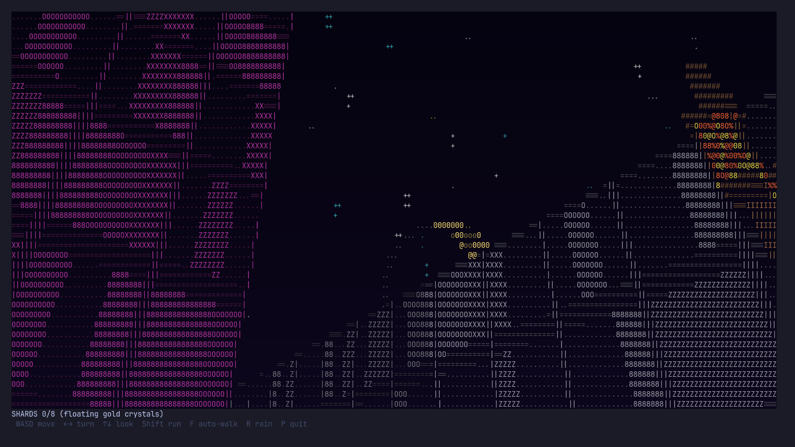

# Static City (native terminal edition)

Walk through an abandoned city drawn entirely in text characters, right in your
Linux terminal.

Everyone has left. The streets are empty, the cars are still parked, and the
lamps are still on. Wander between neon towers, cross bridges over a lake, cut
through parks, look up at the stars and the moon, and find the eight gold data
shards hidden around the city.

It looks like ASCII art, but it is a real first-person 3D world. Every
character on screen is its own ray traced through the city, so you can look up
and down in full perspective. It is written in C as a single source file with no
dependencies, so it starts instantly, uses very little CPU, and runs smoothly
even over SSH.

<!-- Add screenshots here, for example:

-->


## Requirements

- Linux (or another Unix-like system, such as macOS)
- A C compiler (`gcc` or `clang`); `make` is optional
- A terminal that supports UTF-8 and colors, in a monospace font

No other libraries to install. The only link is the standard math library.

## Build and run

```bash
make
./ascii-city
```

Without `make`:

```bash
gcc -O2 -o ascii-city ascii-city.c -lm
./ascii-city
```

`make run` builds and starts it in one step, and `make clean` removes the
program.

Make the terminal window large. 120 columns by 40 rows or bigger looks best.
The game fits itself to your window and adjusts if you resize it while playing.

A terminal with true color support (GNOME Terminal, Konsole, Kitty, Alacritty,
iTerm2, WezTerm, the VS Code terminal) shows the full neon colors. Older
terminals fall back to 256 colors. If the colors look wrong, try:

```bash
COLORTERM=truecolor ./ascii-city
```

## Controls

| Key | Action |
|---|---|
| `W` `A` `S` `D` | Move forward, left, back, right |
| Left and right arrows (or `Q` `E`) | Turn |
| Up and down arrows (or `Z` `X`, `Page Up` `Page Down`) | Look up and down, up to straight up and straight down |
| `Shift` (or type a capital letter) | Run |
| `F` | Toggle auto-walk forward (`S` stops it) |
| `R` | Toggle rain |
| `P` or `Ctrl+C` | Quit |

The top line below the view shows how many shards you have found. When you
quit, your terminal is restored to how it was.

### About holding keys

Terminals cannot report when a key is released, so each key press moves or
turns you a short distance. Holding a key works, but there is a small pause
before it starts repeating. That pause is your keyboard's repeat delay, not
the game. `F` auto-walk avoids it: press `F`, then steer with the arrow keys.

## What is in the city

- **A 77 x 77 city** of streets, sidewalks and towers in orange, yellow, blue,
  green, cyan and magenta, with lit windows and distance fog.
- **A lake** with animated water, crossed by bridges, with a waist-high wooden
  fence along the shore. The posts and rails meet at right angles.
- **Parks** with five kinds of trees, each with its own shape and height: oak,
  tall cypress, low bush, white-trunked birch, and an autumn tree with orange
  and red leaves.
- **Parked cars** facing different ways. Each one is a solid shape with a body,
  cabin, round wheels, headlights, grille, taillights and a plate, so it looks
  right from every side.
- **Street lamps** with a base, pole, arm and two glowing lanterns. Each one
  lights a warm pool on the ground around it.
- **Eight gold data shards** floating above the streets. Walk up to one to
  collect it.
- **A night sky** with a dome of fixed stars (including a faint band like the
  Milky Way) and a waxing crescent moon. You can look straight up at it.
- **Rain** that you can switch on and off.

## How it works

The game is a small raycaster written without any libraries.

- **The world** is a grid. The city, lake, parks, cars, lamps and shards are
  generated from a hash function, so the city is the same every time you play.
- **Rendering:** each character cell on the screen casts one 3D ray from the
  player's eye, using the player's turn and tilt. The ray walks the grid cell
  by cell until it hits something. Because the camera really rotates, looking
  up does not shrink the buildings or lift you off the ground.
- **Buildings** are textured walls, with window patterns picked by position.
- **Cars, trees, fences, lamps and shards** are not flat pictures. Their shapes
  are tested exactly against each ray (ray against box, sphere or cylinder),
  and they are see-through where they have gaps, so you can look through fence
  rails and between leaves.
- **Characters and color:** what the ray hits decides the character (`O X Z 8`
  for lit windows, `~` for water, `"` for grass and so on) and the color. Far
  things fade with distance.
- **The sky** is a true dome. The stars and the moon sit at fixed directions,
  so they stay put as you turn and tilt.
- **Output:** each frame is written to the terminal as one block of colored
  text, only changing the color code when it changes, at about 30 frames per
  second. The terminal is put into raw mode so keys arrive instantly, and it is
  restored when you quit, even if you resize the window or press `Ctrl+C`.

## Project structure

```
ascii-city.c    The whole game (single C source file)
Makefile        Builds it with `make`
ascii-city.js   The original Node.js version (optional, same game)
README.md       This file
```

Add the built `ascii-city` program to your `.gitignore` so it does not get
committed.

## Troubleshooting

| Problem | Fix |
|---|---|
| Colors look washed out or blocky | Use a true color terminal, or run with `COLORTERM=truecolor` |
| Strange characters instead of `~` water | Your terminal or locale is not set to UTF-8 |
| The view flickers | Try a faster terminal such as Kitty or Alacritty, or make the window a little smaller |
| The picture looks stretched | Use a font where cells are about twice as tall as they are wide (most monospace fonts) |
| Keys keep moving after you let go | Normal: each press moves a short distance. Tap instead of holding, or use `F` |
| `make: gcc: command not found` | Install a compiler, for example `sudo apt install build-essential` |

## Tips

- The sky is easiest to see from open spots like the lake shore or a park.
  Between tall towers most of it is blocked.
- The shards float at about waist height. Look for a small glowing gold
  diamond.
- Press `R` for rain.

